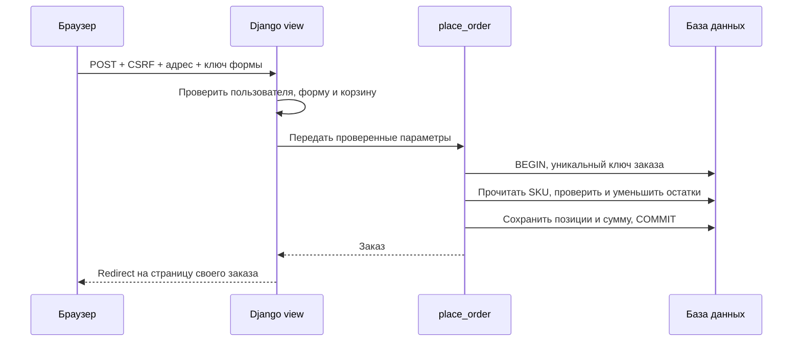

# Backend Lab — учимся Python и Django на работающем магазине

Это учебный проект на русском: сайт, исходный код с объяснениями, 12 уроков и практические задания. Здесь можно пройти путь запроса от браузера до SQL, разобраться с регистрацией, корзиной, транзакциями и тестами, а затем самостоятельно расширить приложение.

**Начните с запуска ниже, затем откройте раздел «Учебник».** Он показывает те же Markdown-уроки, которые лежат в [docs](docs/README.md). Для чтения на GitHub запуск не требуется.

Проект даёт основу backend-разработки и маршрут дальнейшего обучения. Реальные платежи, восстановление пароля по почте, Redis, Celery, OAuth и распределённая инфраструктура здесь не реализованы: они разобраны как следующие упражнения. Учебный магазин не принимает деньги.

## Что можно попробовать

- Каталог из 12 демотоваров: поиск, категории, пагинация, карточки и остатки по размерам.
- Регистрация, вход и выход, корзина в серверной сессии.
- Оформление заказа: сервер считает сумму, фиксирует цену и списывает остатки в транзакции.
- Повторная отправка одной формы возвращает тот же заказ; чужие заказы закрыты.
- Админка для каталога, фотографий, остатков и просмотра заказов.
- JSON API с пагинацией и проверкой владельца.
- Учебник внутри сайта, адаптивная вёрстка, локальная статика без CDN.
- Автоматические тесты, включая конкурентное оформление на PostgreSQL, и пример CI.

## Быстрый запуск

Нужен **Python 3.12** и Git. Все команды ниже выполняются в корне репозитория — там, где `manage.py`. Для первого запуска PostgreSQL, Docker и Node.js не требуются.

```bash
git clone https://github.com/animoff/ronaldo.git
cd ronaldo
python3.12 -m venv .venv
source .venv/bin/activate
python -m pip install -r requirements.txt
python manage.py migrate
python manage.py seed_demo
python manage.py runserver 127.0.0.1:8000
```

Если репозиторий уже открыт в облачной задаче, используйте существующий checkout: повторное клонирование и отдельный worktree не нужны. В подготовленной облачной среде окружение находится в `/workspace/setup-ronaldo/venv`: активируйте его через `source /workspace/setup-ronaldo/venv/bin/activate`, затем перейдите в `/workspace/ronaldo`.

На Windows вместо первых двух команд окружения:

```powershell
py -3.12 -m venv .venv
.venv\Scripts\Activate.ps1
```

Если политика PowerShell не позволяет активировать окружение, вызывайте `.venv\Scripts\python.exe` напрямую. Дальнейшие команды `python ...` те же.

В локальном браузере откройте адрес, который напечатал `runserver`. В облачном onboarding проверка выполняется внутренними HTTP-запросами; доступность отдельного браузерного preview зависит от интерфейса платформы.

| Путь | Что находится |
|---|---|
| `/` | Главная и вход в обучение |
| `/learn/` | Все уроки |
| `/catalog/` | Учебный магазин |
| `/accounts/register/` | Создание своего аккаунта |
| `/cart/` | Корзина |
| `/orders/` | Ваши заказы после входа |
| `/admin/` | Администрирование |
| `/api/products/` | Публичный JSON-каталог |
| `/health/` | Проверка доступности процесса и БД |

Для доступа в админку создайте **свою** учётную запись:

```bash
python manage.py createsuperuser
```

Готовых паролей и автоматического администратора нет. `seed_demo` можно запускать повторно: существующие товары не дублируются, ваши правки и остатки не перезаписываются. Демотовары показывают CSS-иллюстрации; фотографии можно добавить через админку.

### Что сделали команды

`venv` изолировал библиотеки от системного Python. `pip install` установил зафиксированные версии. `migrate` применил историю изменений схемы БД. `seed_demo` создал примеры предметных данных. `runserver` запустил сервер разработки. Команда `makemigrations` при обычном запуске **не нужна**: миграции уже включены в Git; она нужна после изменения моделей.

## Первый эксперимент за 15 минут

1. Откройте каталог и примените фильтр категории. Посмотрите `?category=...` в URL.
2. Откройте карточку, выберите размер, добавьте две единицы в корзину.
3. Создайте аккаунт и оформите заказ с вымышленным учебным адресом.
4. Убедитесь, что сумма и товары есть в заказе, а остаток уменьшился.
5. Измените цену товара в админке: цена в старом заказе останется прежней.
6. Выйдите и зайдите другим пользователем: первый заказ ему недоступен.
7. Прочитайте [урок о транзакциях](docs/05-transactions.md) и найдите эти правила в `commerce/services.py`.

## Программа обучения

| Урок | Основные вопросы |
|---|---|
| [01. Python](docs/01-python.md) | Что такое окружение, модуль, исключение, тип, Decimal? |
| [02. HTTP и Django](docs/02-http-django.md) | Как запрос проходит через URL, middleware, view и шаблон? |
| [03. SQL и ORM](docs/03-orm-sql.md) | Как моделировать связи, миграции, ограничения, индексы и N+1? |
| [04. Формы и доступ](docs/04-forms-auth.md) | Как работают валидация, cookie, session, пароль и CSRF? |
| [05. Транзакции](docs/05-transactions.md) | Как не продать лишнее и не создать заказ дважды? |
| [06. JSON API](docs/06-api.md) | Что такое контракт, пагинация, статус и разрешение? |
| [07. Тесты](docs/07-testing.md) | Как доказать правильность и поймать регрессию? |
| [08. Безопасность](docs/08-security.md) | Где границы доверия и как защититься от типичных атак? |
| [09. Развёртывание](docs/09-deployment.md) | Зачем PostgreSQL, Gunicorn, Docker, TLS и backup? |
| [10. Архитектура](docs/10-architecture.md) | Когда нужны сервисы, кеш, очередь и outbox? |
| [11. Отладка и Git](docs/11-debugging-git.md) | Как исследовать ошибку и подготовить понятное изменение? |
| [12. План практики](docs/12-roadmap.md) | Что делать самостоятельно и как оценивать прогресс? |

Каждый урок содержит практику и вопросы для самопроверки. Не пытайтесь запомнить весь код: выбирайте действие на сайте, находите его обработчик и объясняйте результат своими словами.

## Карта исходного кода

```text
manage.py                  команды Django
ronaldu/                   настройки, главный URLconf, WSGI/ASGI, health
main/
  models.py                каталог, связи и ограничения БД
  views.py                 поиск, пагинация, подготовка данных шаблону
  admin.py                 управление каталогом
  management/commands/     повторяемое наполнение seed_demo
  migrations/              история схемы, включая исходную миграцию
  tests.py                 проверки каталога и моделей
commerce/
  cart.py                  корзина: в сессии ID и количества, цены из БД
  forms.py                 проверка входных данных
  services.py              атомарная операция оформления заказа
  models.py                заказ и снимки купленных позиций
  views.py                 HTML, права, Post/Redirect/Get
  api.py                   JSON-представление данных
  validation.py            проверка идентификаторов SKU
  tests.py                 доступ, остатки, повтор, API, гонки
academy/                   каталог уроков и Markdown → HTML
templates/                 HTML, наследование шаблонов, CSRF-поля
static/css/site.css        адаптивный интерфейс без сборщика
docs/                      учебник, доступный без запуска сервера
requirements.txt           закреплённые зависимости
compose.yaml               дополнительный локальный стек PostgreSQL + web
.github/workflows/         проверки SQLite и PostgreSQL в CI
```

Имя конфигурационного пакета `ronaldu` сохранено от исходного проекта. В старой модели также сохранён `related_name="prduct_size"`; для читаемого доступа добавлено свойство `product.product_sizes`. Это пример совместимого развития существующего кода.

### Путь оформления заказа



SKU — вариант товара, например футболка размера M. Корзина не резервирует склад: окончательная проверка выполняется при оформлении. Цена никогда не принимается из браузера. Деньги хранятся как `Decimal`. Исключение внутри `atomic` откатывает и заказ, и списание. PostgreSQL блокирует SKU-строки; условный `UPDATE stock >= quantity` защищает остатки. Уникальный ключ одной формы защищает её повтор; два разных оформления — две отдельные покупки.

## Тесты и проверки

```bash
python -m pip check
python manage.py check
python manage.py makemigrations --check --dry-run
python manage.py test --verbosity 2
```

Для отдельной области: `python manage.py test commerce`. Тестовый runner создаёт отдельную БД и удаляет её после запуска. При SQLite проверки именно PostgreSQL-конкуренции пропускаются явно. Запустите ту же команду с PostgreSQL, чтобы проверить блокировки и конкурентные покупки. Нулевой набор тестов не считается проверкой.

Тестируются фильтры, модели и ограничения, пустой/ошибочный ввод, CSRF, чужие заказы, сумма и снимок цены, откат при нехватке товара, повторное оформление, API и страницы учебника. Сетевой smoke test дополнительно проверяет настоящий сервер, который тестовый клиент Django не запускает.

CI-конфигурация выполняет проверки на двух БД после push/PR. Наличие файла workflow само по себе не означает успешный запуск GitHub Actions.

## JSON API

Все три endpoint только для чтения; покупки выполняются HTML-формами с CSRF. Это позволяет сначала разобраться в обычном Django/HTTP, затем как упражнение добавить DRF.

| Запрос | Доступ и результат |
|---|---|
| `GET /api/products/?q=...&category=...&page=1` | Публичный список, 12 товаров на страницу |
| `GET /api/products/<slug>/` | Товар, описание и доступные размеры |
| `GET /api/orders/` | Только заказы пользователя с текущей session cookie |

Пример структуры списка:

```json
{"count": 12, "page": 1, "pages": 1, "next_page": null, "results": []}
```

`results` в живом ответе содержит товары; здесь массив сокращён для показа структуры. Цена — JSON-строка (`"1990.00"`), валюта — `RUB`, время — ISO 8601. Невалидный номер страницы возвращает 400, отсутствующая страница/товар — 404, запрос своих заказов без входа — 401. API использует session authentication, не JWT. Детальный контракт и примеры — [урок 06](docs/06-api.md).

## Настройки окружения

Для старта `.env` не обязателен. Для настройки скопируйте `.env.example` в `.env`; значения процесса имеют приоритет. `.env` не попадает в Git.

| Переменная | Назначение |
|---|---|
| `DEBUG` | `1` локально, `0` для публичного сервера |
| `SECRET_KEY` | Длинный случайный секрет, обязателен при DEBUG=0 |
| `ALLOWED_HOSTS` | Имена хостов через запятую, без схемы |
| `CSRF_TRUSTED_ORIGINS` | Доверенные origins с HTTPS-схемой |
| `POSTGRES_DB` | Непустое значение включает PostgreSQL |
| `POSTGRES_USER/PASSWORD/HOST/PORT` | Параметры соединения PostgreSQL |
| `SQLITE_PATH` | Необязательный другой путь SQLite-файла |
| `TRUST_X_FORWARDED_PROTO` | Только за настроенным доверенным reverse proxy |
| `LOG_LEVEL` | Уровень логирования; по умолчанию INFO |

В DEBUG используется публичный учебный ключ, если SECRET_KEY не задан. Он подходит только локальному демонстрационному режиму. Для production задайте собственный ключ и HTTPS; не храните секрет в README, Git или Dockerfile.

### PostgreSQL и Docker

Обычный Python может подключаться к установленному PostgreSQL через перечисленные переменные. Либо используйте Compose: задайте свой `POSTGRES_PASSWORD` в `.env`, затем:

```bash
docker compose up --build -d
docker compose exec web python manage.py seed_demo
docker compose exec web python manage.py createsuperuser
docker compose exec web python manage.py test
docker compose down
```

Это локальный учебный стек. `down` сохраняет named volumes; добавление `-v` удаляет данные. Тестовой роли нужно право создания тестовой БД. Для production требуется отдельная конфигурация и HTTPS. Подробная последовательность: [урок 09](docs/09-deployment.md).

### Развёртывание

При установленных production-переменных выполните `migrate`, `collectstatic --noinput`, `check --deploy --fail-level WARNING`, затем запустите `gunicorn ronaldu.wsgi:application` за reverse proxy. В production статика использует manifest: собирайте её с `DEBUG=0`. Фотографии пользователей храните и раздавайте отдельно от WhiteNoise. Текущие настройки не заменяют rate limiting входа, мониторинг, backup и проверку восстановления.

## Когда что-то не работает

| Ошибка | Действие |
|---|---|
| `No module named django` | Активировать venv и установить requirements тем же Python |
| `no such table` | Проверить выбранную БД, выполнить migrate |
| Пустой каталог | Выполнить seed_demo |
| 403 при POST | Проверить CSRF, cookie, origin и HTTPS-настройки |
| `database is locked` | Закончить конкурирующие SQLite-записи; для гонок перейти на PostgreSQL |
| CSS/manifest отсутствует | Выполнить collectstatic в соответствующем режиме DEBUG |
| Нет доступа в админку | Создать superuser, обычная регистрация не даёт staff-права |
| `connection refused` PostgreSQL | Проверить процесс, host, port; в Compose host — db |

## Как развивать проект

Начните с брендов и фильтра, затем добавьте избранное, отмену заказа с однократным возвратом остатков, отзывы с проверкой покупки. Для каждой функции сначала сформулируйте правила и ошибки, затем напишите тесты, код и короткое объяснение. Полный маршрут и критерии самостоятельности — [урок 12](docs/12-roadmap.md).

Понимание приходит, когда вы можете объяснить не только успешный запрос, но и поведение при повторе, нехватке товара, чужом доступе и отказе базы.
